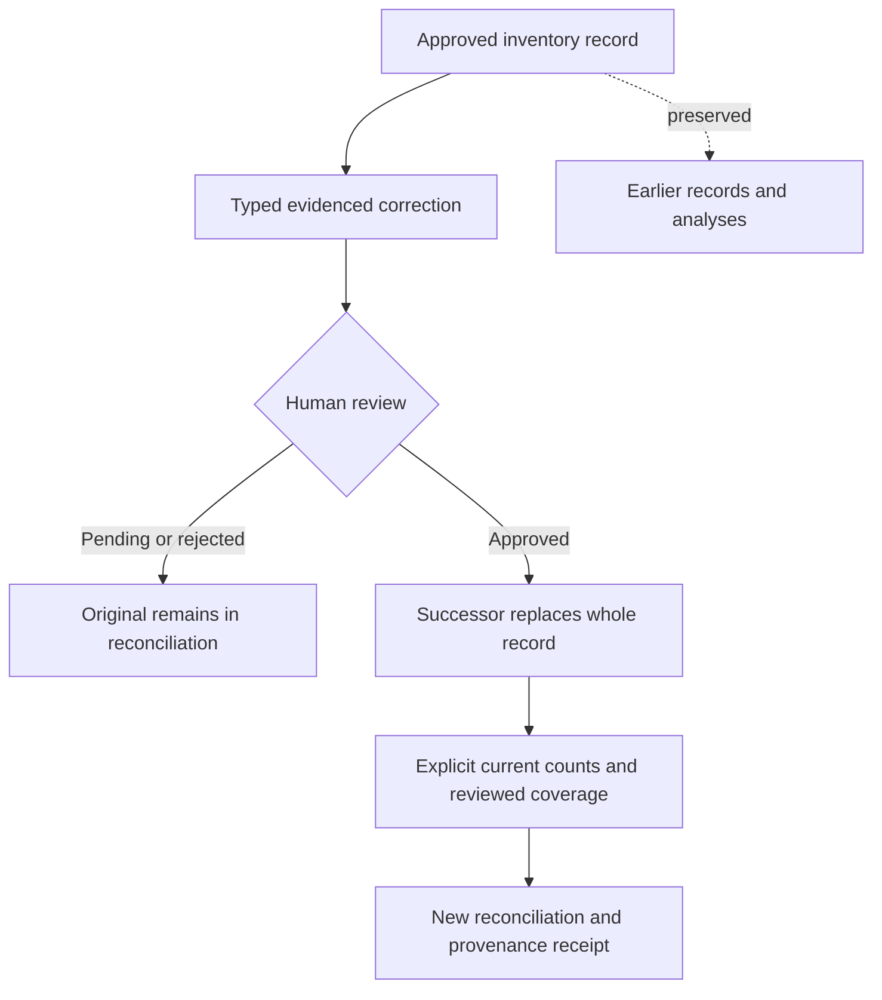

# Reviewed inventory corrections

Milestone **C13** · backend scope · 2026-10-11. See [validation](VALIDATION.md) and the [development map](PROGRESS.md).

## Record replacement

A correction is a new evidenced count, movement, recipe or fulfillment linked to an approved predecessor of the same kind and business. An editor can propose it; only an owner or reviewer can approve or reject it. Approval replaces the **whole record**. Quantity, units, item/product, warehouse, event time, recipe interval and evidence may be corrected. Earlier records, decisions and analysis input/result receipts remain immutable.

Pending corrections do not block or change reconciliation of the approved predecessor. This differs deliberately from independent pending records: those still make the existing reconciliation incomplete because potentially missing events need review. Competing correction candidates may exist, but the database permits only one approved successor. Rejected candidates do not consume the replacement slot; later revisions target the winning successor. Stale competing candidates may be rejected.

A replacement may move an event outside a period or revise a recipe interval; the original does not reappear. Missing recipe coverage remains an incomplete result. Changes to warehouse/item/time affect subsequent scope selection. Ordinary, unrelated overlapping recipes retain the existing ambiguity behavior; this checkpoint does not introduce a global recipe-overlap exclusion constraint.

Opening and closing count selectors are explicit. If an analysis names a replaced count, it fails with the latest approved successor ID so the caller can choose the current count. It never silently substitutes a count with a potentially different item, warehouse or cutoff. Unapproved correction counts cannot be selected. Normal scope validation still applies after selecting the successor.

## API and lifecycle

Apply migration **14** before running the updated API. All endpoints require authentication and same-business membership. Proposal and decision operations retain idempotency keys. Ordinary proposal/analysis payloads are unchanged, including their hashes. Pure inventory and stateless Quick input models have no persistent correction selector.

| Route | Contract |
|---|---|
| `POST /businesses/{business}/records/{id}/corrections` | `{record_kind, replacement}`; kind selects the existing typed count/movement/recipe/fulfillment input. The replacement requires a new ID and `status: proposed`. |
| `POST /businesses/{business}/records/{id}/decision` | Existing approval/rejection and reason; targets the correction ID. Existing independent-duplicate review still applies. |
| `GET /businesses/{business}/records/{id}` | Existing source/detail/decision/origin plus lifecycle state, immediate approved successor, `whole_record` correction scope and bounded ancestor links. |
| `GET /businesses/{business}/records` | Review/history list with optional `state`, `kind`, `supersedes`, `after` and `limit`. |

The new list returns `{records, next_cursor}` using ascending UUID order, default 20 and maximum 50 records. States are `pending`, `approved`, `rejected`, `superseded`; approved is a review state, not a statement that an event falls in a requested analysis period. Filters and pages use the caller's tenant snapshot; changes between pages can change filtered results. New correction/list routes and existing record detail reads use `Cache-Control: no-store`. Inventory detail quantities and recipe yields now serialize as decimal strings to preserve large fractional values; clients must not convert them through binary floats. Internal creation transaction identifiers are not exposed in record responses.

Successful retries return the original stored result after later corrections; changed payloads cannot reuse the same idempotency key. Failed writes commit neither a result key nor an audit event.

## Duplicate review and imported rows

Correcting an event is not a new independent occurrence. Candidate matching excludes the correction's ancestor records, approved superseded records and competing versions of those same ancestors. Identical-file candidates exclude ancestor document IDs before their list limit. Unrelated matching records and other identical documents remain candidates; approval still needs `distinct_event` and a reason when those candidates exist. No semantic similarity or automatic business-event identity inference is introduced.

Import source rows remain immutable and reserved. A correction cannot claim a second imported origin or release the source-row reuse guard. Corrected values are manually reviewed inputs with their own evidence locator; they are never presented as freshly extracted cell values. The original extracted values remain in inherited provenance.

## New analysis receipts

New reconciliation excludes replaced records and unapproved correction candidates before time/scope filtering. It retains the unchanged deterministic calculator and numerical definitions. Each new analysis adds `correction_provenance`: a flat ordered chain per selected corrected record containing record/predecessor IDs, kind, depth, document ID/hash and locator, author/review metadata, and any original import row/mapping/extraction references. `source_provenance` continues to contain direct import origins for selected imported records.

Ancestry is limited to 64 correction links. Receipts refuse more than 10,000 lineage rows or 8 MiB of encoded correction provenance; they never silently truncate it. Current selected evidence is hash-verified. Ancestor document hashes and import data are retained historical references, not a claim that each ancestor file was reread or that its original figures equal the corrected figures. Advisor context includes the saved correction receipt under its existing 64 KiB bound.

Earlier analyses stay snapshots. Approval does not recalculate old analyses, rewrite case context, or attest that earlier coverage assertions remain adequate. Request a new reconciliation with reviewed current counts and coverage. [C14](INVENTORY_FRESHNESS.md) adds a separate live input comparison and suppresses stale/unknown figures in current advice. Its final full PostgreSQL suite passed **313 tests**, with **one real-OCR skip**; Ruff passed.

## Database sealing and numerical boundary

Migration 14 adds same-business predecessor links and a unique approved-successor index. A trigger stamps new headers with their actual creation transaction. Typed detail, recipe lines and import origins must be inserted with the unreviewed header; a correction cannot acquire an import origin. Deferred validation requires matching typed detail and at least one recipe line. Approval validates structure and derives its predecessor from the immutable record, ignoring forged decision links. The guards also reject additions after approval in the same transaction.

Existing rows receive no invented creation transaction and are closed to new detail/line/origin additions. Existing RLS, reviewer/author checks and append-only triggers remain active. The migration does not retroactively certify legacy data inserted outside normal service paths.

Recipe preparation yield now uses the same context-independent precision check as other bounded inputs. Extra fractional tails beyond six stored places are rejected before persistence, preventing silent rounding; insignificant trailing zeros remain valid. The consumption formula is unchanged.

## Remaining work

Catalog/unit-definition correction, semantic invoice matching, broader PDF/image mapping, stock valuation, production/intermediate goods, actual OCR/model quality, accounting review, backup/restore and full application capacity remain open. C14's freshness comparison does not close those gates. The visible Persian portfolio remains user-deferred. Synthetic software checks do not prove production readiness or document truth.
