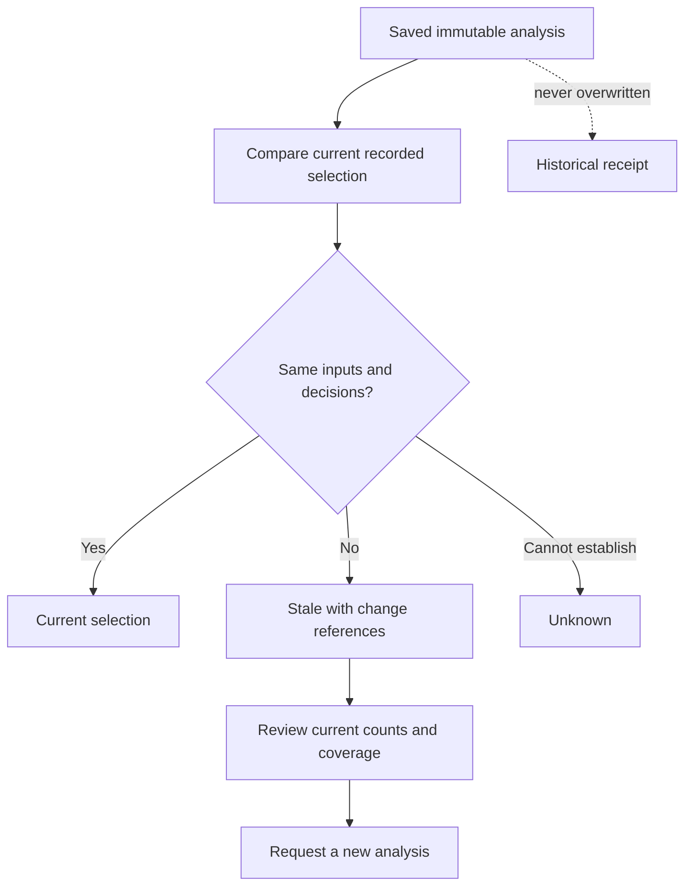

# Inventory analysis freshness and change impact

Milestone **C14**, validated backend scope. The [development map](PROGRESS.md) records checkpoint state and remaining product gates.

## What is compared

An inventory analysis is an immutable calculation receipt. Its read-time freshness is a separate comparison against currently recorded inputs in the same business and database snapshot. The shared selector uses the original warehouse, half-open event period, and explicit opening/closing count IDs. It includes current approved records and independent pending records, excludes rejected/superseded records, and excludes pending/rejected correction candidates. Items and unit conversions cover the business; recipes overlap the period across the business, matching the existing calculation input contract.

Typed values and review status are compared by collection and record ID. List order, timezone representation of an equal instant, and insignificant decimal zeros do not change their meaning. Saved input hashes, typed result format and matching result/request scope and target are checked before interpretation. This does not add a result-integrity hash or recalculate the saved figures. Matching inputs yield `current`; additions, removals or changed values/status yield `stale`; invalid/unsupported receipts or comparison limits yield `unknown`. Current does not mean complete: an unchanged incomplete analysis is still incomplete.

This conservative comparison can mark an analysis stale for a newly selected item or recipe that does not change its numerical answer. It does not claim that a changed answer exists. No recalculation happens during reads, and no numerical impact is guessed. New evidence files or other unselected counts do not alone invalidate a selection. A rejected independent candidate can restore the original selection, making the earlier receipt current again.

## Corrections and count selection

Pending and rejected corrections leave the original selected. Approved corrections remove the predecessor and add the successor if it meets selection rules. Moving an event or recipe into/out of the scope changes those sets. A replaced explicit count is removed without selecting the successor automatically; `count_selection_required` names the role, original ID and latest approved successor where available. The caller must check the successor's item, warehouse, date and evidence before creating a new analysis.

## Response and advice boundaries

`GET /businesses/{business}/inventory-analyses/{id}` returns the existing historical fields plus `freshness`, with `Cache-Control: no-store`. The underlying service receipt read and idempotent creation responses remain unchanged. The new section contains comparison version, check time, status, nullable stale flag, reason, change totals/examples and count-selection requirements. `unknown` returns no change totals, because an incomplete comparison must not be presented as exhaustive.

Portfolio previews retain the analysis ID, scope and original completion status. For stale/unknown analyses they suppress shortage and review flags and explain the need for a new analysis. Advisor context similarly withholds result figures and numeric import/correction provenance, while retaining receipt metadata and freshness. Current complete results remain available for typed advice; current incomplete results keep their missing-data explanation. Saved case turns retain their original context exactly; subsequent turns retrieve new freshness.

No file bytes are reread during this comparison. The response declares `evidence_verification: not_rechecked`. Current means equal recorded selection; it does not certify source-file integrity, undisclosed documents, coverage assertions, accounting compliance or a real-world inventory count. Creating a new analysis still performs the existing current-evidence hash checks.

## Bounds and access

Comparison is limited to 10,000 input rows (including recipe lines) and 8 MiB of encoded input data. At most 20 examples are returned per change category; totals remain exact and each sample declares whether it is truncated. Comparison overflow yields unknown; example truncation does not. Existing tenant membership and RLS apply. The comparison writes no records, audit events or result receipts and requires no migration beyond C13's migration 14.

## Acceptance

The final PostgreSQL suite passed **313 tests**, including **36 freshness cases**, with **one real-OCR skip**. The focused suite passed 36 in 129.54 seconds. Ruff, local documentation links and whitespace checks passed; code-only graph refresh and checkpoint artifacts are synchronized. See [validation](VALIDATION.md) and [the run record](../runs/inventory-freshness-2026-10-11/README.md). Software checks use synthetic inputs. Real OCR/model quality, catalog correction, operational capacity/recovery, official accounting review and the deferred owner interface remain separate gates.
