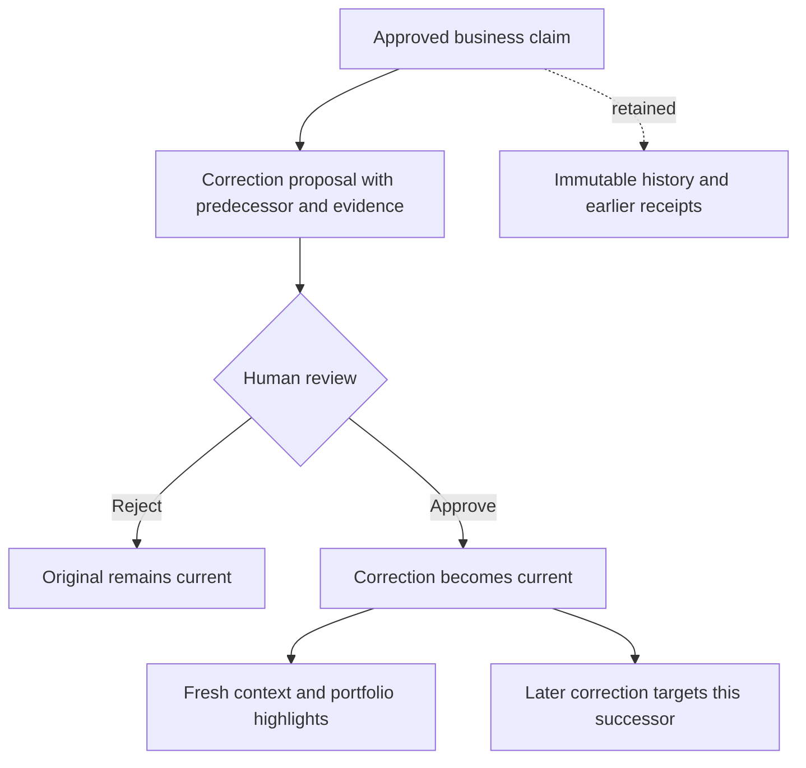

# Reviewed knowledge corrections

Milestone **C12** · backend scope · 2026-10-11. Validation is recorded in [VALIDATION.md](VALIDATION.md).

## Workflow and meaning

An editor proposes a corrected Persian statement with evidence and a `supersedes` claim ID. An owner or reviewer reads the new proposal and its immediate predecessor, then approves or rejects it with a reason. Only approval replaces the predecessor. No claim, decision, original document or saved case receipt is edited.

**Replacement covers the whole claim, including validity dates.** The new proposal must use the same knowledge key, but may revise the statement, evidence and interval. After approval the original never becomes current again, including dates outside the new interval. Those dates return missing unless another independent approved claim applies. This makes a corrected date range explicit and avoids hidden fallback to known outdated information. For a genuine policy change over time, retain distinct claims with explicit non-overlapping validity intervals; replacing an open-ended claim with a bounded correction can close its interval.

Validity remains inclusive at `valid_from` and exclusive at `valid_to`; timestamps require timezones. `effective_at` selects applicability under **current review state**, not the approval state that existed at a past date. Saved receipts show what was actually retrieved earlier.

Only an approved, not-yet-replaced same-business claim can be a new correction's predecessor. Several pending candidates may target it, but at most one can be approved. Rejected candidates do not consume that right. A pending candidate that loses a concurrent review remains pending and may be rejected; approving it is refused. Later corrections target the winning successor. Independent overlapping claims remain visible as conflicts; identical independent statements retain all their sources.

## API

All routes require authentication and business membership. Editors, reviewers and owners may propose; only reviewers and owners may decide. Reads permit viewers. Existing proposal/decision routes require an idempotency key. The model has no approval or posting tools.

| Route | C12 behavior |
|---|---|
| `POST /businesses/{business}/knowledge` | Existing fields plus optional `supersedes: UUID`. Omit for an independent claim. |
| `POST /businesses/{business}/knowledge/{id}/decision` | Existing `approved` and `reason_fa`; approval checks predecessor eligibility and replacement evidence bytes. |
| `GET /businesses/{business}/knowledge/{id}` | Original `claim` and `decision`, lifecycle `state`, immediate `predecessor` with its current-state flag, approved `superseded_by` ID, and `correction_scope: whole_claim` for corrections. |
| `GET /businesses/{business}/knowledge` | Bounded history/review list; optional `state`, `knowledge_key`, `supersedes`, `after`, `limit`. |

The list returns `{claims, next_cursor, correction_scope}`. States are `pending`, `approved`, `rejected`, `superseded`. Here `approved` means reviewed and not replaced; an expired or future-dated approved claim still has this lifecycle state. Only context and overview additionally filter by `effective_at`.

Rows include ID, key, 300-character preview/truncation flag, validity dates, creation time, predecessor, successor and state. The default limit is 20, maximum 50; UUID cursors are ascending, not chronological. Each page uses a consistent database snapshot, while review changes between requests can change state-filtered results. Use detail reads for full evidence and review reasons. List and detail responses use `Cache-Control: no-store`. The list also retains the common 64 KiB response bound; narrow the page if it exceeds that bound. A missing predecessor filter yields no rows without revealing other tenants.

An existing ordinary proposal serializes exactly as before when `supersedes` is absent or null, preserving idempotency hashes. Repeating the same successful correction or decision key returns its stored result even after later corrections. A different payload cannot reuse that key.

## Retrieval and history

Fresh business context excludes any claim with an approved successor **before** the 20-claim limit, date filtering and conflict grouping. Returned current claims include their immediate `supersedes` ID and hash-verified evidence. Long replacement histories therefore do not exhaust the current-context claim limit. The 64 KiB context limit remains unchanged; no hidden truncation is introduced.

Portfolio key counts, conflict counts, ordering and highlights use the same exclusion rule. Pending review counts still include stale candidates awaiting rejection. Highlight sources expose predecessor IDs. Portfolio previews do not verify knowledge-file bytes; full advisor context does, as before.

Case continuations rebuild current knowledge, while old turns and their hashes remain exact. Narrative corrections do not alter journal entries, financial statements, reports or inventory analyses; those use separate typed data and review workflows. Historical lineage is available through linked detail reads and paginated lists rather than copied into every model prompt.

## Database boundary

Apply migration **13** with the existing migration CLI before starting the updated API. It adds nullable predecessor columns to claims/decisions, a same-business claim foreign key, a predecessor lookup index and a unique approved-successor index. Existing rows retain null predecessor values; no stored receipt or claim content is rewritten.

The claim trigger requires an already approved same-key predecessor, preventing self/cyclic construction. The decision trigger derives the predecessor from the immutable claim rather than trusting supplied SQL values. The unique index arbitrates concurrent approvals even when both transactions read the same earlier snapshot. All operations retain existing tenant RLS, author/reviewer policies and append-only triggers. Idempotency keys and audit events are committed with successful writes; failed approval transactions publish neither.

## Scope limits

This is explicit narrative correction, not semantic document matching, automatic contradiction resolution, a financial adjustment mechanism or historical approval reconstruction. An approval is a human judgment; hash verification proves file integrity, not statement truth. Inventory corrections, broader document matching, real OCR/model evaluation, accounting review, recovery/capacity and the user-deferred visible portfolio remain open.
