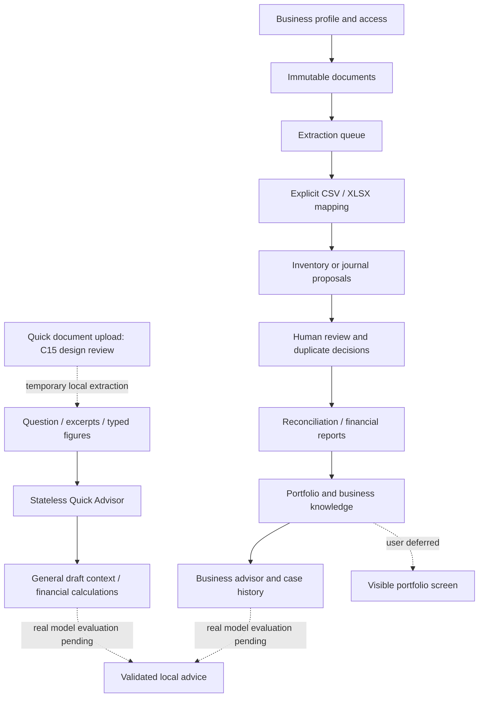

# Herman development map

Updated: **2026-10-11** · Active phase: **Backend workflows** · Latest checkpoint: **C14 — Inventory analysis freshness and impact**

**Last delivered:** saved inventory analyses expose current/stale/unknown input comparisons and change references. Portfolio/advisor summaries withhold stale or unknown figures while preserving historical receipts. The full PostgreSQL suite passes **313 tests**, with **one real-OCR fixture test skipped**. **Working now:** C15 stateless document intake for Quick Advisor, at design review. No C15 implementation or validation is claimed.

This map separates capabilities from acceptance gates. A verified checkpoint means its documented scope passed checks; it does not mean every feature in that segment is finished. There is no overall percentage because engine quality, operational readiness and deferred UI are different kinds of work.

## You are here

| Position | Milestone | State / evidence |
|---|---|---|
| Last verified | **C14 · Inventory analysis freshness and impact** | [Run record](../runs/inventory-freshness-2026-10-11/README.md): 313 passed, one OCR skip; 36 new freshness checks. [Commit e843048](https://github.com/alisunkazemi21-cloud/Herman-SME-Financial-Advisor-Perisan/commit/e84304831588f199a05f45bca2731104e7dff980) passed [GitHub run 38168599926](https://github.com/alisunkazemi21-cloud/Herman-SME-Financial-Advisor-Perisan/actions/runs/38168599926). |
| Current work | **C15 · Stateless Quick document intake** | Design review: existing parsers and Quick limits inspected; contract and implementation still pending. Detailed stages below. |
| Current segments | **S2 · Evidence and review + S4 · Advisor and knowledge** | Connect temporary document extraction to request-only Quick sources; preserve explicit typed calculations. |
| Most recently advanced | **S3 · Financial and inventory core** | Corrections, current-input comparison and preserved receipts verified at C13–C14; catalog and accounting depth remain open. |
| Later UI | **S5 · Owner experience** | Deferred by the user; portfolio data already exists in the backend. |

Status vocabulary: **verified** means the stated scope has passing evidence; **design review** means requirements or source inspection is underway before implementation; **in progress** means implementation has started but acceptance is unfinished; **planned** means no implementation claim; **gate open** means required evidence is missing; **deferred** means deliberately postponed. A segment can have verified capabilities and open gates at the same time.

## Workflow map

Solid paths exist in the backend within their documented bounds. Dashed paths show work or validation still outstanding. Advisors cannot approve or post financial records.

## Capability segments

| Segment | Working and verified scope | Remaining work / exit gate |
|---|---|---|
| S1 · Business foundation | Profiles, membership, tenant isolation, restricted database role, idempotent writes and audit events | Backup/restore and full application capacity. Existing 1,000-business benchmark covers synthetic reads only. |
| S2 · Evidence and review | Immutable uploads, queue recovery, CSV/XLSX extraction/mapping, row provenance, exact duplicate checks, human decisions | Three labeled real OCR invoices; semantic invoice matching; broader PDF/image table mapping. |
| S3 · Financial and inventory core | Recipes/consumption reconciliation, reviewed corrections and input freshness/impact; sealed recipe structure; balanced journals, reversals, reviewed report mappings and cash-flow/KPI payloads | Catalog correction, closing controls, gross bank-flow classification, larger reports and official accounting-standard verification. |
| S4 · Advisor and knowledge | Reviewed knowledge/correction history, bounded context, opt-in local drafts, immutable business cases and general stateless Quick inputs with twelve typed calculations | Stateless binary document ingestion and actual local-model quality evaluation. |
| S5 · Owner experience | Earlier Persian RTL prototype; backend portfolio and five indicators | Visible business portfolio remains user-deferred. Licensed Kalameh assets are unavailable; Contour is planned for a later UI checkpoint. |
| S6 · Production validation | PostgreSQL regression tests, GitHub checks, evidence-preserving artifacts and local Graphify navigation | Restore drill, complete workload/capacity testing, real-engine acceptance and deployment hardening. |

## Checkpoint history

Tests listed below are historical full-suite results, not completion percentages or comparable measures of business value. They use synthetic inputs unless explicitly stated in [validation](VALIDATION.md).

| ID · Date | Capability gained | Full-suite evidence |
|---|---|---|
| C01 · Oct 05 | Local ingestion, ledger, ratios, forecasts and Persian prototype | 58 passed after the prototype follow-up; 1 skipped |
| C02 · Oct 05 | Multi-business inventory backend | [86 passed; 1 skipped](BACKEND_ACCEPTANCE.md) |
| C03 · Oct 06 | Durable extraction queue | [93 passed; 1 skipped](DOCUMENT_QUEUE.md) |
| C04 · Oct 06 | Inventory table imports and duplicate review | [108 passed; 1 skipped](TABULAR_IMPORTS.md) |
| C05 · Oct 08 | Reviewed knowledge and portfolio payloads | [122 passed; 1 skipped](ADVISOR_PORTFOLIO.md) |
| C06 · Oct 08 | Local advisor draft routes | [135 passed; 1 skipped](VALIDATION.md#local-advisor-draft-checkpoint--2026-10-08); a later added case passed in the focused suite |
| C07 · Oct 09 | Persistent business cases | [145 passed; 1 skipped](BUSINESS_CASES.md) |
| C08 · Oct 10 | Tenant journals and trial balance | [163 passed; 1 skipped](JOURNALS.md) |
| C09 · Oct 10 | Reviewed reports feeding portfolio/advisor | [174 passed; 1 skipped](JOURNAL_REPORTS.md) |
| C10 · Oct 11 | Document rows → atomic journal proposals → report lineage | [195 passed; 1 skipped](JOURNAL_IMPORTS.md) |
| C11 · Oct 11 | General Quick questions, excerpts and partial financial figures | [226 passed; 1 skipped](QUICK_ADVISOR.md) |
| C12 · Oct 11 | Reviewed claim replacements, current-context selection and retained history | [250 passed; 1 skipped](KNOWLEDGE_CORRECTIONS.md) |
| C13 · Oct 11 | Reviewed inventory replacements, sealed recipes and retained import ancestry | [277 passed; 1 skipped](INVENTORY_CORRECTIONS.md) |
| **C14 · Oct 11** | **Input freshness/change impact; stale figures withheld from current advice; exact receipts retained** | **[313 passed; 1 skipped](INVENTORY_FRESHNESS.md)** |

Documentation-language, typography and Graphify checkpoints are supporting changes recorded in [validation](VALIDATION.md). They did not independently close a product capability gate.

## Last verified checkpoint: C14

Delivered: shared selection for creation and read-time freshness; additions/removals/value or decision changes; explicit replacement-count requirements; bounded unknown status; suppression of stale/unknown current-advice figures; and unchanged historical analysis/case receipts. The final suite passed **313 tests**, including **36** new freshness cases, with one real-OCR skip. Ruff and whitespace checks passed. Freshness does not certify source integrity or business completeness.

Evidence: [contract](INVENTORY_FRESHNESS.md), [run record](../runs/inventory-freshness-2026-10-11/README.md), [tests](../tests/test_inventory_freshness.py), [technical report](../reports/inventory-freshness-2026-10-11_technical.md). No migration beyond 14 is needed. Repository automation is visible in [GitHub checks](https://github.com/alisunkazemi21-cloud/Herman-SME-Financial-Advisor-Perisan/actions/workflows/tests.yml).

## Forward checkpoints and acceptance gates

These are intended work groups, not calendar promises. Each is complete only when its listed outcome has direct evidence.

### C15 · Stateless Quick document intake — design review

Business outcome: an owner can submit a document for a small Quick question without first creating a business profile or retaining a conversation history.

| Stage | Current state | Observable exit |
|---|---|---|
| 1 · Design | **Working now** | Record the supported formats, resource limits, source-location contract and failure cleanup before code. |
| 2 · Implementation | Planned | A separate stateless extraction path supplies unverified sources to existing Quick routes. |
| 3 · Validation | Pending implementation | Supported-format, limits, failure/cleanup, privacy and regression checks pass. |
| 4 · Publication | Pending validation | Contract and checkpoint artifacts agree; a commit is pushed and its exact GitHub check result is recorded. |

Inspection completed: existing CSV/XLSX, PDF and image extractors, the persistent worker's subprocess handling, and Quick's eight-source / 6,000-character-per-source / 64 KiB context bounds. **Immediate decision:** how to preserve page/row references and enforce complete temporary cleanup and resource limits without silently omitting content. This inspection is preparation, not an accepted C15 contract.

| Step | Expected behavior | Completion evidence |
|---|---|---|
| Define intake | Specify file types, size/page/row limits and parser isolation before implementation. | Recorded contract aligned with existing local parsers and Quick bounds. |
| Extract locally | Return unverified text/structure with source hash and locator references. | Synthetic supported-format fixtures, failure cases and explicit unsupported-engine behavior. |
| Stay stateless | Use temporary processing without business records or history. | No tenant/history access, no saved evidence rows, no request carryover and verified cleanup. |
| Keep numbers typed | Extracted text does not become confirmed financial figures or model arithmetic. | Provenance and input-validation checks; existing typed calculations remain the numerical boundary. |
| Close checkpoint | Synchronize implementation, evidence, progress map and Git history. | Focused checks, full regression result, commit and CI outcome. |

C15 implementation is planned; supported formats and exact parser limits are not yet finalized. Broader semantic mapping, catalog correction, real OCR/model quality and operational acceptance remain separate gates. UI work remains deferred.

| Next group | Expected outcome | Evidence needed to close it |
|---|---|---|
| N1 · General Quick Advisor | Request/context scope verified at C11; binary intake is planned at C15; real answer quality remains under N3 | [C11 contract and evidence](QUICK_ADVISOR.md); stateless file intake and real-engine checks |
| N2 · Corrections and document understanding | Knowledge correction verified at C12, inventory correction at C13 and freshness at C14; catalog and broader document handling remain open | Catalog correction contracts, deterministic conflict resolution and realistic duplicate/non-duplicate fixtures |
| N3 · Operational and engine acceptance | Demonstrate the system's real operating limits and advice quality | Three labeled OCR invoices, actual local model evaluation, recoverable backup/restore and representative multi-business workloads |
| N4 · Owner-facing portfolio | Business overview, cash-flow diagram, indicators and knowledge highlights | Resume UI work with user direction; browser/accessibility checks, Persian typography and tested Contour integration |
| N5 · Accounting depth | Close/report controls and verified accounting rules | Authoritative standard versions, accountant-reviewed fixtures and independent expected results |

## Update rule

At each checkpoint, update the last-verified/current-work markers in this map and the root README, capability segments, historical result and exact commit/check links. Between checkpoints, identify the current stage and next observable exit without changing the last verified milestone. Keep unresolved gates visible. Report updates as **checkpoint ID → capability gained → validation → remaining gate → next step**. Record failure/recovery evidence in `VALIDATION.md`, preserve earlier receipts, and use the same milestone IDs in the run README, research chapter and technical report. The conversation visualization is a dated snapshot; this repository map is the maintained reference.
