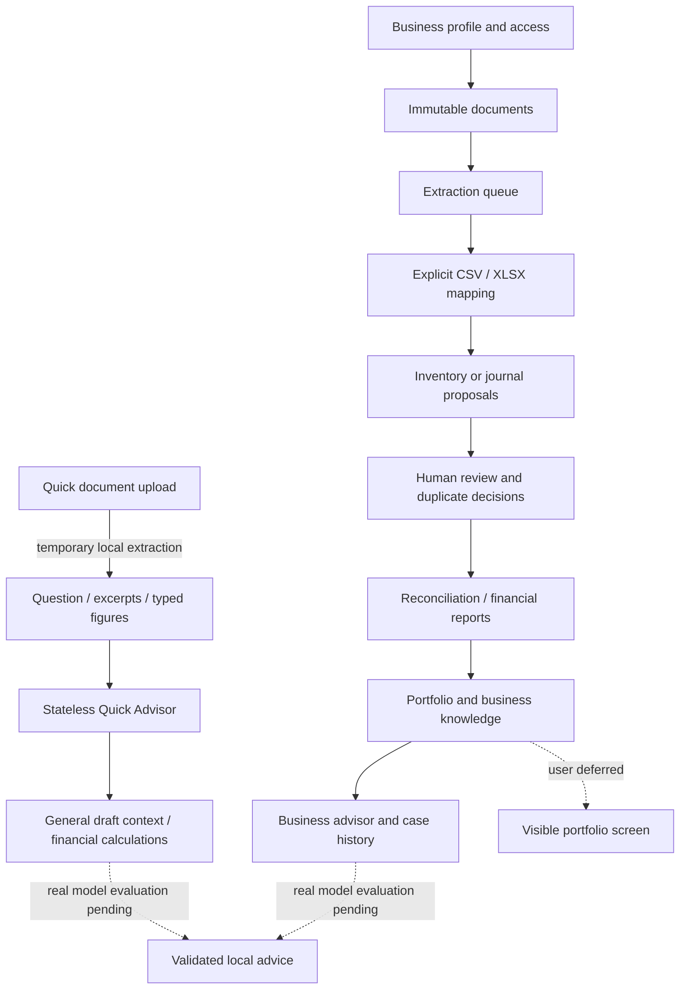

# Herman development map

Updated: **2026-10-13** · Active phase: **Backend workflows** · Last verified checkpoint: **C15 — Stateless Quick document intake** · Current work: **C16 implementation**

**Last delivered:** temporary document extraction supplies unverified, source-linked text to Quick without business history or persistent records. The local full PostgreSQL run passed **362 tests**, with **one real-OCR skip**; final Quick checks passed **86 tests**, including all **50 intake cases**. A POSIX descendant cleanup race failed the first Linux run; [the repair run](https://github.com/alisunkazemi21-cloud/Herman-SME-Financial-Advisor-Perisan/actions/runs/38315758134) passed **362 tests** with two skips, then Ruff and Marimo checks. **Current work:** C16 event-time calculation implemented ([slice evidence](../runs/dated-inventory-2026-10-13/README.md)): 387 local passes / one skip; 386 Linux passes / two skips. Pack revision storage and internal human review passed 396 Windows tests / one skip and 395 Linux tests / two skips ([persistence evidence](../runs/pack-catalog-2026-10-13/README.md)); analysis/freshness integration and item aliases remain open.

This map separates capabilities from acceptance gates. A verified checkpoint means its documented scope passed checks; it does not mean every feature in that segment is finished. There is no overall percentage because engine quality, operational readiness and deferred UI are different kinds of work.

## You are here

| Position | Milestone | State / evidence |
|---|---|---|
| Last verified | **C15 · Stateless Quick document intake** | [Run record](../runs/quick-documents-2026-10-12/README.md): 362 full-suite passes / one OCR skip, followed by 86 final Quick checks. [GitHub checks](https://github.com/alisunkazemi21-cloud/Herman-SME-Financial-Advisor-Perisan/actions/workflows/tests.yml). |
| Current implementation | **C16 · Reviewed catalog/unit correction** | [Compatibility and lifecycle contract](CATALOG_CORRECTIONS.md) defines prospective revisions and immutable history. The dated calculator and internal pack revision storage/review are implemented; public workflow integration remains open. |
| Most recently advanced | **S2 · Evidence and review + S4 · Advisor and knowledge** | Temporary document extraction, exact source locations, bounded cleanup and reusable unverified Quick sources. |
| Next segment | **S3 · Financial and inventory core** | Catalog and conversion changes must preserve historical meaning and affect current selection explicitly. |
| Later UI | **S5 · Owner experience** | Deferred by the user; portfolio data already exists in the backend. |

Status vocabulary: **verified** means the stated scope has passing evidence; **design review** means requirements or source inspection is underway before implementation; **in progress** means implementation has started but acceptance is unfinished; **planned** means no implementation claim; **gate open** means required evidence is missing; **deferred** means deliberately postponed. A segment can have verified capabilities and open gates at the same time.

## Workflow map

Solid paths exist in the backend within their documented bounds. Dashed paths show work or validation still outstanding. Advisors cannot approve or post financial records.

## Capability segments

| Segment | Working and verified scope | Remaining work / exit gate |
|---|---|---|
| S1 · Business foundation | Profiles, membership, tenant isolation, restricted database role, idempotent writes and audit events | Backup/restore and full application capacity. Existing 1,000-business benchmark covers synthetic reads only. |
| S2 · Evidence and review | Immutable uploads, queue recovery, CSV/XLSX mapping, duplicate decisions; separate bounded temporary Quick extraction with source locations | Three labeled real OCR invoices; semantic invoice matching; broader PDF/image financial-table mapping. |
| S3 · Financial and inventory core | Recipes/consumption reconciliation, reviewed corrections and input freshness/impact; sealed recipe structure; balanced journals, reversals, reviewed report mappings and cash-flow/KPI payloads | Catalog correction, closing controls, gross bank-flow classification, larger reports and official accounting-standard verification. |
| S4 · Advisor and knowledge | Reviewed knowledge/corrections, bounded context, local draft routes, immutable cases, stateless Quick questions/documents and twelve typed calculations | Actual local-model quality and reliable financial interpretation of varied documents. |
| S5 · Owner experience | Earlier Persian RTL prototype; backend portfolio and five indicators | Visible business portfolio remains user-deferred. Licensed Kalameh assets are unavailable; Contour is planned for a later UI checkpoint. |
| S6 · Production validation | PostgreSQL regression tests, GitHub checks, evidence-preserving artifacts and local Graphify navigation | Restore drill, complete workload/capacity testing, real-engine acceptance and deployment hardening. |

## Checkpoint history

Tests listed below are historical full-suite results, not completion percentages or comparable measures of business value. They use synthetic inputs unless explicitly stated in [validation](VALIDATION.md).

| ID · Date | Capability gained | Full-suite evidence |
|---|---|---|
| C01 · Oct 05 | Local ingestion, ledger, ratios, forecasts and Persian prototype | 58 passed after the prototype follow-up; 1 skipped |
| C02 · Oct 05 | Multi-business inventory backend | [86 passed; 1 skipped](BACKEND_ACCEPTANCE.md) |
| C03 · Oct 06 | Durable extraction queue | [93 passed; 1 skipped](DOCUMENT_QUEUE.md) |
| C04 · Oct 06 | Inventory table imports and duplicate review | [108 passed; 1 skipped](TABULAR_IMPORTS.md) |
| C05 · Oct 08 | Reviewed knowledge and portfolio payloads | [122 passed; 1 skipped](ADVISOR_PORTFOLIO.md) |
| C06 · Oct 08 | Local advisor draft routes | [135 passed; 1 skipped](VALIDATION.md#local-advisor-draft-checkpoint--2026-10-08); a later added case passed in the focused suite |
| C07 · Oct 09 | Persistent business cases | [145 passed; 1 skipped](BUSINESS_CASES.md) |
| C08 · Oct 10 | Tenant journals and trial balance | [163 passed; 1 skipped](JOURNALS.md) |
| C09 · Oct 10 | Reviewed reports feeding portfolio/advisor | [174 passed; 1 skipped](JOURNAL_REPORTS.md) |
| C10 · Oct 11 | Document rows → atomic journal proposals → report lineage | [195 passed; 1 skipped](JOURNAL_IMPORTS.md) |
| C11 · Oct 11 | General Quick questions, excerpts and partial financial figures | [226 passed; 1 skipped](QUICK_ADVISOR.md) |
| C12 · Oct 11 | Reviewed claim replacements, current-context selection and retained history | [250 passed; 1 skipped](KNOWLEDGE_CORRECTIONS.md) |
| C13 · Oct 11 | Reviewed inventory replacements, sealed recipes and retained import ancestry | [277 passed; 1 skipped](INVENTORY_CORRECTIONS.md) |
| C14 · Oct 11 | Input freshness/change impact; stale figures withheld from current advice; exact receipts retained | [313 passed; 1 skipped](INVENTORY_FRESHNESS.md); [exact-commit CI](https://github.com/alisunkazemi21-cloud/Herman-SME-Financial-Advisor-Perisan/actions/runs/38168599926) |
| **C15 · Oct 12** | **Temporary Quick documents with source references, cleanup and no business history** | **[362 passed; 1 skipped](QUICK_DOCUMENTS.md)**; final 86 Quick checks after locator fix |

Documentation-language, typography and Graphify checkpoints are supporting changes recorded in [validation](VALIDATION.md). They did not independently close a product capability gate.

## Last verified checkpoint: C15

Delivered: raw-byte local extraction, bounded source packing, exact page/row/image references, temporary process/file cleanup, no business-state access, explicit engine failures, credential recheck and sanitized no-store Quick responses. The full suite passed **362 tests** with one real-OCR skip. After preserving whitespace in sheet-name locators, all **86** focused Quick checks passed, including **50** intake cases. Ruff and whitespace checks passed. Extracted text and resubmitted metadata remain unverified; financial amounts require typed input.

Evidence: [contract](QUICK_DOCUMENTS.md), [run record](../runs/quick-documents-2026-10-12/README.md), [tests](../tests/test_quick_documents.py), [technical report](../reports/quick-documents-2026-10-12_technical.md). No migration beyond 14 is needed. Repository automation is visible in [GitHub checks](https://github.com/alisunkazemi21-cloud/Herman-SME-Financial-Advisor-Perisan/actions/workflows/tests.yml).

## Forward checkpoints and acceptance gates

These are intended work groups, not calendar promises. Each is complete only when its listed outcome has direct evidence.

### C16 · Reviewed catalog/unit correction — in progress

Business outcome: an owner can correct catalog or conversion definitions without rewriting the meaning of historical records or saved analyses.

| Stage | Current state | Observable exit |
|---|---|---|
| 1 · Design | **In progress** | [Initial contract](CATALOG_CORRECTIONS.md) sets identity, compatible revisions and historical meaning. The calculation envelope is fixed; migration and database lifecycle still need design. |
| 2 · Implementation | **Partial: dated calculator + pack persistence** | Reviewed replacements preserve earlier definitions and receipts. |
| 3 · Validation | **Focused arithmetic passed; full workflow pending** | Independent arithmetic, compatibility, tenant/role, concurrent approval and historical-receipt checks pass. |
| 4 · Publication | **Calculation slice pushed; full C16 pending** | Contract and checkpoint artifacts agree; a commit is pushed and its exact GitHub check result is recorded. |

The selected C16 direction is reviewed prospective revisions for compatible catalog labels and pack factors; a base-unit dimension change requires a new item identity and explicit stock handover. The internal calculator now captures dated definition uses; migration 15 stores pack definitions and decisions. Public routes, historical record bindings, item/SKU revisions and analysis/freshness integration remain to implement and verify. Broader semantic mapping, real OCR/model quality and operational acceptance remain separate gates. UI work remains deferred.

| Next group | Expected outcome | Evidence needed to close it |
|---|---|---|
| N1 · General Quick Advisor | Request/context scope verified at C11 and temporary document intake at C15; real answer quality remains under N3 | [Quick inputs](QUICK_ADVISOR.md), [document intake](QUICK_DOCUMENTS.md) and real-engine evaluation |
| N2 · Corrections and document understanding | Knowledge correction verified at C12, inventory correction at C13 and freshness at C14; catalog and broader document handling remain open | Catalog correction contracts, deterministic conflict resolution and realistic duplicate/non-duplicate fixtures |
| N3 · Operational and engine acceptance | Demonstrate the system's real operating limits and advice quality | Three labeled OCR invoices, actual local model evaluation, recoverable backup/restore and representative multi-business workloads |
| N4 · Owner-facing portfolio | Business overview, cash-flow diagram, indicators and knowledge highlights | Resume UI work with user direction; browser/accessibility checks, Persian typography and tested Contour integration |
| N5 · Accounting depth | Close/report controls and verified accounting rules | Authoritative standard versions, accountant-reviewed fixtures and independent expected results |

## Update rule

At each checkpoint, update the last-verified/current-work markers in this map and the root README, capability segments, historical result and exact commit/check links. Between checkpoints, identify the current stage and next observable exit without changing the last verified milestone. Keep unresolved gates visible. Report updates as **checkpoint ID → capability gained → validation → remaining gate → next step**. Record failure/recovery evidence in `VALIDATION.md`, preserve earlier receipts, and use the same milestone IDs in the run README, research chapter and technical report. The conversation visualization is a dated snapshot; this repository map is the maintained reference.
