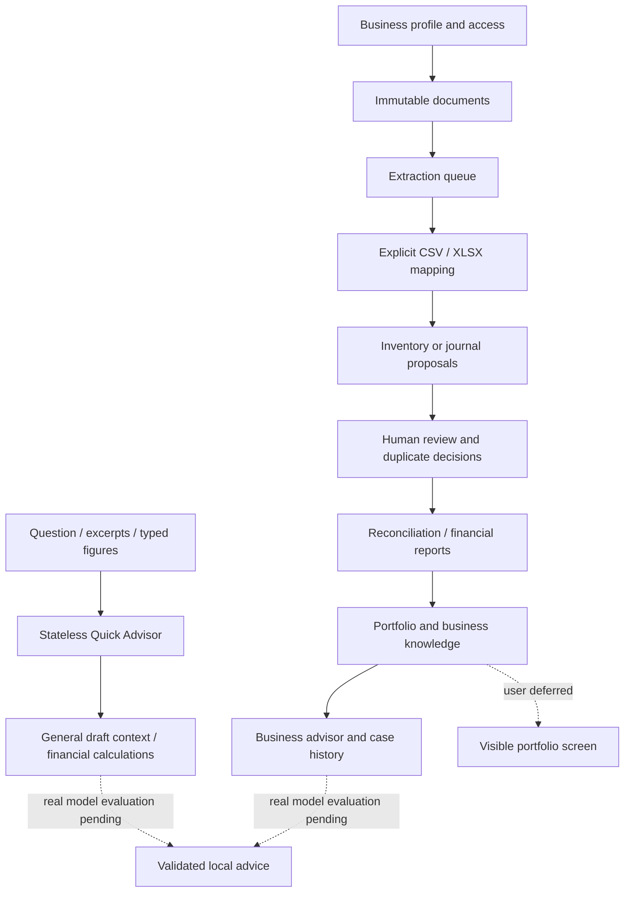

# Herman development map

Updated: **2026-10-11** · Active phase: **Backend workflows** · Latest checkpoint: **C13 — Reviewed inventory corrections**

**Now:** all four inventory record kinds support reviewed corrections, with retained import ancestry and sealed recipe structure. New reconciliation uses current approved versions; earlier results stay snapshots. The full PostgreSQL suite passes **277 tests**, with **one real-OCR fixture test skipped**. The product is still in development. **Next intended checkpoint:** inventory analysis freshness and correction impact reporting.

This map separates capabilities from acceptance gates. A verified checkpoint means its documented scope passed checks; it does not mean every feature in that segment is finished. There is no overall percentage because engine quality, operational readiness and deferred UI are different kinds of work.

## You are here

| Position | Milestone | State / evidence |
|---|---|---|
| Last verified | **C13 · Reviewed inventory corrections** | [Run record](../runs/inventory-corrections-2026-10-11/README.md): 277 passed, one OCR skip; 27 new correction cases in the full suite. [GitHub checks](https://github.com/alisunkazemi21-cloud/Herman-SME-Financial-Advisor-Perisan/actions/workflows/tests.yml). |
| Next planned | **C14 · Inventory analysis freshness and impact** | Planning only; no implementation or validation claimed. Detailed scope below. |
| Current segment | **S3 · Financial and inventory core** | Reviewed inventory revisions and retained analysis lineage are verified; old-analysis freshness is the next gap. |
| Later UI | **S5 · Owner experience** | Deferred by the user; portfolio data already exists in the backend. |

Status vocabulary: **verified** means the stated scope has passing evidence; **in progress** means implementation has started but acceptance is unfinished; **planned** means no implementation claim; **gate open** means required evidence is missing; **deferred** means deliberately postponed. A segment can have verified capabilities and open gates at the same time.

## Workflow map

Solid paths exist in the backend within their documented bounds. Dashed paths show work or validation still outstanding. Advisors cannot approve or post financial records.

## Capability segments

| Segment | Working and verified scope | Remaining work / exit gate |
|---|---|---|
| S1 · Business foundation | Profiles, membership, tenant isolation, restricted database role, idempotent writes and audit events | Backup/restore and full application capacity. Existing 1,000-business benchmark covers synthetic reads only. |
| S2 · Evidence and review | Immutable uploads, queue recovery, CSV/XLSX extraction/mapping, row provenance, exact duplicate checks, human decisions | Three labeled real OCR invoices; semantic invoice matching; broader PDF/image table mapping. |
| S3 · Financial and inventory core | Recipes/consumption reconciliation and reviewed corrections; sealed recipe structure; balanced journals, reversals, reviewed report mappings and cash-flow/KPI payloads | Inventory-analysis freshness/impact, catalog correction, closing controls, gross bank-flow classification, larger reports and official accounting-standard verification. |
| S4 · Advisor and knowledge | Reviewed knowledge/correction history, bounded context, opt-in local drafts, immutable business cases and general stateless Quick inputs with twelve typed calculations | Stateless binary document ingestion and actual local-model quality evaluation. |
| S5 · Owner experience | Earlier Persian RTL prototype; backend portfolio and five indicators | Visible business portfolio remains user-deferred. Licensed Kalameh assets are unavailable; Contour is planned for a later UI checkpoint. |
| S6 · Production validation | PostgreSQL regression tests, GitHub checks, evidence-preserving artifacts and local Graphify navigation | Restore drill, complete workload/capacity testing, real-engine acceptance and deployment hardening. |

## Checkpoint history

Tests listed below are historical full-suite results, not completion percentages or comparable measures of business value. They use synthetic inputs unless explicitly stated in [validation](VALIDATION.md).

| ID · Date | Capability gained | Full-suite evidence |
|---|---|---|
| C01 · Oct 05 | Local ingestion, ledger, ratios, forecasts and Persian prototype | 58 passed after the prototype follow-up; 1 skipped |
| C02 · Oct 05 | Multi-business inventory backend | [86 passed; 1 skipped](BACKEND_ACCEPTANCE.md) |
| C03 · Oct 06 | Durable extraction queue | [93 passed; 1 skipped](DOCUMENT_QUEUE.md) |
| C04 · Oct 06 | Inventory table imports and duplicate review | [108 passed; 1 skipped](TABULAR_IMPORTS.md) |
| C05 · Oct 08 | Reviewed knowledge and portfolio payloads | [122 passed; 1 skipped](ADVISOR_PORTFOLIO.md) |
| C06 · Oct 08 | Local advisor draft routes | [135 passed; 1 skipped](VALIDATION.md#local-advisor-draft-checkpoint--2026-10-08); a later added case passed in the focused suite |
| C07 · Oct 09 | Persistent business cases | [145 passed; 1 skipped](BUSINESS_CASES.md) |
| C08 · Oct 10 | Tenant journals and trial balance | [163 passed; 1 skipped](JOURNALS.md) |
| C09 · Oct 10 | Reviewed reports feeding portfolio/advisor | [174 passed; 1 skipped](JOURNAL_REPORTS.md) |
| C10 · Oct 11 | Document rows → atomic journal proposals → report lineage | [195 passed; 1 skipped](JOURNAL_IMPORTS.md) |
| C11 · Oct 11 | General Quick questions, excerpts and partial financial figures | [226 passed; 1 skipped](QUICK_ADVISOR.md) |
| C12 · Oct 11 | Reviewed claim replacements, current-context selection and retained history | [250 passed; 1 skipped](KNOWLEDGE_CORRECTIONS.md) |
| **C13 · Oct 11** | **Reviewed inventory replacements, sealed recipes and retained import ancestry** | **[277 passed; 1 skipped](INVENTORY_CORRECTIONS.md)** |

Documentation-language, typography and Graphify checkpoints are supporting changes recorded in [validation](VALIDATION.md). They did not independently close a product capability gate.

## Current checkpoint: C13

Delivered: reviewed whole-record corrections for counts, movements, recipes and fulfillments; explicit current-count selection; one approved successor under concurrent review; creation-transaction sealing; independent duplicate review and stored correction/import ancestry. Earlier receipts remain immutable. The full suite passed **277 tests**, including **27** new correction cases, with one real-OCR skip. A final record-detail no-store adjustment passed its focused API check. Ruff and whitespace checks passed. Recipe-yield precision no longer silently rounds on persistence.

Evidence: [contract](INVENTORY_CORRECTIONS.md), [run record](../runs/inventory-corrections-2026-10-11/README.md), [tests](../tests/test_inventory_corrections.py), [migration](../src/backend/migration_014.sql), [technical report](../reports/inventory-corrections-2026-10-11_technical.md). Repository automation is visible in [GitHub checks](https://github.com/alisunkazemi21-cloud/Herman-SME-Financial-Advisor-Perisan/actions/workflows/tests.yml).

## Forward checkpoints and acceptance gates

These are intended work groups, not calendar promises. Each is complete only when its listed outcome has direct evidence.

### C14 · Inventory analysis freshness and impact — planned

Business outcome: an owner or advisor can distinguish a saved reconciliation from one that still covers the currently reviewed inputs, and identify what changed without rewriting the earlier result.

| Step | Expected behavior | Completion evidence |
|---|---|---|
| Define freshness | Specify which selected/current record, review and scope changes invalidate an earlier analysis. | Recorded contract and decision before implementation. |
| Detect changes | Identify replacements and newly applicable or removed inputs without silently recomputing a saved result. | Independent stale/current expectations across record kinds and time boundaries. |
| Expose impact | Add clear freshness/impact information to analysis retrieval, portfolio previews and advisor context. | API and context checks that avoid presenting known stale numbers as current findings. |
| Preserve history | Stored input/result/context receipts remain exact; recalculation creates a new reviewed run. | Before/after receipt and idempotency comparisons. |
| Close checkpoint | Synchronize implementation, evidence, progress map and Git history. | Focused checks, full regression result, commit and CI outcome. |

Broader document matching, catalog correction and real-engine/operational acceptance remain separate work. C14 is planned; the final freshness contract must account for the actual selection rules and avoid a broader freshness claim than the evidence supports.

| Next group | Expected outcome | Evidence needed to close it |
|---|---|---|
| N1 · General Quick Advisor | Request/context scope verified at C11; real answer quality remains under N3 | [C11 contract and evidence](QUICK_ADVISOR.md); binary document intake remains open |
| N2 · Corrections and document understanding | Knowledge correction verified at C12 and inventory correction at C13; freshness, catalog and broader document handling remain open | Change-impact contracts, deterministic conflict resolution and realistic duplicate/non-duplicate fixtures |
| N3 · Operational and engine acceptance | Demonstrate the system's real operating limits and advice quality | Three labeled OCR invoices, actual local model evaluation, recoverable backup/restore and representative multi-business workloads |
| N4 · Owner-facing portfolio | Business overview, cash-flow diagram, indicators and knowledge highlights | Resume UI work with user direction; browser/accessibility checks, Persian typography and tested Contour integration |
| N5 · Accounting depth | Close/report controls and verified accounting rules | Authoritative standard versions, accountant-reviewed fixtures and independent expected results |

## Update rule

At each checkpoint, update the current/next marker in this map and the root README, capability segments, historical result and evidence links. Keep unresolved gates visible. Report updates as **checkpoint ID → capability gained → validation → remaining gate → next step**. Record failure/recovery evidence in `VALIDATION.md`, preserve earlier receipts, and use the same milestone IDs in the run README, research chapter and technical report. The conversation visualization is a dated snapshot; this repository map is the maintained reference.
