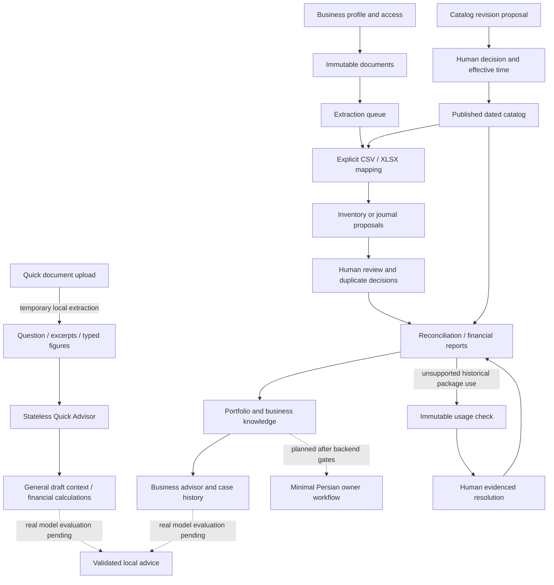

# Herman development map

Updated: **2026-10-26** · Active phase: **Backend workflows** · Last verified checkpoint: **C16 — Reviewed catalog/unit correction** · Current work: **C17 completeness/actions — implementation under regression**

**Last accepted:** C16's compatible-edit backend workflow, code `f877b9b`, passed **544 Windows tests / one real-OCR skip** and **543 Linux tests / two skips**, then Ruff/Marimo. [Acceptance matrix and run](../runs/catalog-workflow-2026-10-26/README.md). **Now:** C17 has twelve-category dataset-bound completeness reviews, provisional/current-advice guards and immutable investigation/action history. Component/API checks passed; the full fresh-database regression is running. [Implementation and pending acceptance](../runs/completeness-actions-2026-10-26/README.md).

This map separates capabilities from acceptance gates. A verified checkpoint means its documented scope passed checks; it does not mean every feature in that segment is finished. There is no overall percentage because engine quality, operational readiness and deferred UI are different kinds of work.

## Forty-day delivery target

**Day 1: October 24 · Day 40: December 2, 2026.** The founder is available full-time and will approach a pilot business in week one; access remains unconfirmed. Follow the [dated milestones](MVP_40_DAY_PLAN.md) and [specialist responsibilities](AGENT_TEAM.md). C16 is accepted; pilot readiness and the other delivery gates remain open. Backend acceptance comes first, followed by a minimal Persian owner workflow. Earlier UI-deferral labels below describe the prior checkpoint state.

## Independent reliability slice: dependency readiness

Implemented under M40-1: separate `/ready` database feature and evidence-root I/O probes, generic no-store responses, database timeout settings and per-process single-flight admission retained through HTTP cancellation. The scoped PostgreSQL readiness/backend suite passed **15 tests**; independent review found and verified a cancellation repair. Full Windows regression passed **407 tests / one skip**; Linux code-commit CI passed **406 tests / two skips**, plus Ruff and Marimo. This reliability slice is **verified** within [its documented scope](../runs/readiness-2026-10-25/README.md). Restore, engine-quality and full workload-capacity gates remain open; C16 acceptance is recorded below.

## You are here

| Position | Milestone | State / evidence |
|---|---|---|
| Last verified | **C16 · Reviewed catalog/unit correction** | [Accepted workflow](../runs/catalog-workflow-2026-10-26/README.md): 544 Windows passes / one skip, 543 Linux passes / two skips at code `f877b9b`. |
| In validation | **C17 · Completeness and reviewed actions** | Twelve explicit categories, reviewed no-event assertions, changed/pending/provisional guards and named investigation follow-up are implemented. Full regression/CI acceptance remains pending. |
| Most recently advanced | **S2 + S3 · Evidence/review and financial/inventory core** | Current labels and public reviewed catalog/binding operations now complete the historical interpretation workflow. [API guide](CATALOG_API.md). |
| Next segment | **S2 + S3 · Reliable pilot evidence** | Category-level completeness and accountable reviewed follow-up, retaining missing/stale/unknown states. |
| Later UI | **S5 · Owner experience** | Minimal Persian owner workflow follows backend gates. Existing portfolio data is available; pricing is now specified but not implemented. |

Status vocabulary: **verified** means the stated scope has passing evidence; **design review** means requirements or source inspection is underway before implementation; **in progress** means implementation has started but acceptance is unfinished; **planned** means no implementation claim; **gate open** means required evidence is missing; **deferred** means deliberately postponed. A segment can have verified capabilities and open gates at the same time.

## Workflow map

Solid paths exist in the backend within their documented bounds. Dashed paths show work or validation still outstanding. Advisors cannot approve or post financial records.

## Capability segments

| Segment | Working and verified scope | Remaining work / exit gate |
|---|---|---|
| S1 · Business foundation | Profiles, membership, tenant isolation, restricted database role, idempotent writes and audit events | Backup/restore and full application capacity. Existing 1,000-business benchmark covers synthetic reads only. |
| S2 · Evidence and review | Immutable uploads, queue recovery, CSV/XLSX mapping, duplicate decisions; separate bounded temporary Quick extraction with source locations | Three labeled real OCR invoices; semantic invoice matching; broader PDF/image financial-table mapping. |
| S3 · Financial and inventory core | Reconciliation, reviewed corrections/freshness; dated catalog and historical interpretation with public review; balanced journals and reviewed report/portfolio payloads | Category completeness/actions, closing controls, gross bank-flow classification, larger reports and official accounting verification. |
| S4 · Advisor and knowledge | Reviewed knowledge/corrections, bounded context, local draft routes, immutable cases, stateless Quick questions/documents and twelve typed calculations | Actual local-model quality and reliable financial interpretation of varied documents. |
| S5 · Owner experience | Earlier Persian RTL prototype; backend portfolio and five indicators | Minimal Persian owner workflow after backend gates, with Kalameh fallback until licensed assets are available and inspected Contour integration. |
| S6 · Production validation | PostgreSQL regression tests, GitHub checks, evidence-preserving artifacts and local Graphify navigation | Restore drill, complete workload/capacity testing, real-engine acceptance and deployment hardening. |

## Checkpoint history

Tests listed below are historical full-suite results, not completion percentages or comparable measures of business value. They use synthetic inputs unless explicitly stated in [validation](VALIDATION.md).

| ID · Date | Capability gained | Full-suite evidence |
|---|---|---|
| C01 · Oct 05 | Local ingestion, ledger, ratios, forecasts and Persian prototype | 58 passed after the prototype follow-up; 1 skipped |
| C02 · Oct 05 | Multi-business inventory backend | [86 passed; 1 skipped](BACKEND_ACCEPTANCE.md) |
| C03 · Oct 06 | Durable extraction queue | [93 passed; 1 skipped](DOCUMENT_QUEUE.md) |
| C04 · Oct 06 | Inventory table imports and duplicate review | [108 passed; 1 skipped](TABULAR_IMPORTS.md) |
| C05 · Oct 08 | Reviewed knowledge and portfolio payloads | [122 passed; 1 skipped](ADVISOR_PORTFOLIO.md) |
| C06 · Oct 08 | Local advisor draft routes | [135 passed; 1 skipped](VALIDATION.md#local-advisor-draft-checkpoint--2026-10-08); a later added case passed in the focused suite |
| C07 · Oct 09 | Persistent business cases | [145 passed; 1 skipped](BUSINESS_CASES.md) |
| C08 · Oct 10 | Tenant journals and trial balance | [163 passed; 1 skipped](JOURNALS.md) |
| C09 · Oct 10 | Reviewed reports feeding portfolio/advisor | [174 passed; 1 skipped](JOURNAL_REPORTS.md) |
| C10 · Oct 11 | Document rows → atomic journal proposals → report lineage | [195 passed; 1 skipped](JOURNAL_IMPORTS.md) |
| C11 · Oct 11 | General Quick questions, excerpts and partial financial figures | [226 passed; 1 skipped](QUICK_ADVISOR.md) |
| C12 · Oct 11 | Reviewed claim replacements, current-context selection and retained history | [250 passed; 1 skipped](KNOWLEDGE_CORRECTIONS.md) |
| C13 · Oct 11 | Reviewed inventory replacements, sealed recipes and retained import ancestry | [277 passed; 1 skipped](INVENTORY_CORRECTIONS.md) |
| C14 · Oct 11 | Input freshness/change impact; stale figures withheld from current advice; exact receipts retained | [313 passed; 1 skipped](INVENTORY_FRESHNESS.md); [exact-commit CI](https://github.com/alisunkazemi21-cloud/Herman-SME-Financial-Advisor-Perisan/actions/runs/38168599926) |
| **C15 · Oct 12** | **Temporary Quick documents with source references, cleanup and no business history** | **[362 passed; 1 skipped](QUICK_DOCUMENTS.md)**; final 86 Quick checks after locator fix |
| **C16 · Oct 26** | **Reviewed compatible catalog changes, dated labels and historical-use resolution through the public API** | **[544 Windows passes / one skip; 543 Linux passes / two skips](../runs/catalog-workflow-2026-10-26/README.md)**; code `f877b9b`, Ruff/Marimo passed |

Documentation-language, typography and Graphify checkpoints are supporting changes recorded in [validation](VALIDATION.md). They did not independently close a product capability gate.

## Previous checkpoint: C15

Delivered: raw-byte local extraction, bounded source packing, exact page/row/image references, temporary process/file cleanup, no business-state access, explicit engine failures, credential recheck and sanitized no-store Quick responses. The full suite passed **362 tests** with one real-OCR skip. After preserving whitespace in sheet-name locators, all **86** focused Quick checks passed, including **50** intake cases. Ruff and whitespace checks passed. Extracted text and resubmitted metadata remain unverified; financial amounts require typed input.

Evidence: [contract](QUICK_DOCUMENTS.md), [run record](../runs/quick-documents-2026-10-12/README.md), [tests](../tests/test_quick_documents.py), [technical report](../reports/quick-documents-2026-10-12_technical.md). No migration beyond 14 is needed. Repository automation is visible in [GitHub checks](https://github.com/alisunkazemi21-cloud/Herman-SME-Financial-Advisor-Perisan/actions/workflows/tests.yml).

## Forward checkpoints and acceptance gates

These are intended work groups, not calendar promises. Each is complete only when its listed outcome has direct evidence.

### C16 · Reviewed catalog/unit correction — accepted

Business outcome: an owner can correct catalog or conversion definitions without rewriting the meaning of historical records or saved analyses.

| Stage | Current state | Observable exit |
|---|---|---|
| 1 · Design | **Accepted compatible-edit contract** | Stable identity, immutable history, prospective decisions and explicit unsupported dimension changes are fixed in [the contract](CATALOG_CORRECTIONS.md). |
| 2 · Implementation | **Public workflow implemented** | Dated labels, item/pack proposals/decisions, historical checks/resolutions and shared consumers are available through authenticated bounded APIs. |
| 3 · Validation | **Passed within C16 scope** | 544 Windows passes / one real-OCR skip; 543 Linux passes / two skips, with independent arithmetic, concurrency, tenant/role/source, migration and saved-receipt checks. |
| 4 · Publication | **Code published with passing CI** | `f877b9b`, [exact-code CI](https://github.com/alisunkazemi21-cloud/Herman-SME-Financial-Advisor-Perisan/actions/runs/40307392553), [API guide](CATALOG_API.md) and synchronized checkpoint artifacts. |

C16 is accepted for compatible name/SKU and pack-factor revisions within the stated backend bounds. Cross-identity stock migration, a visible owner workflow, broader document understanding and production/customer acceptance remain separate. [Requirement-by-requirement evidence](../runs/catalog-workflow-2026-10-26/README.md#acceptance-mapping).

### C17 · Evidence completeness and reviewed follow-up — planned

Outcome: a weekly reconciliation can identify missing categories and retain accountable investigations/actions instead of treating record absence as proof of no activity. Distinguish reviewed no-event assertions, missing/late/conflicting evidence and actual observations. Retain reviewer, evidence, responsible owner, follow-up time and confirmed outcome without claiming a cause or saving from the variance alone. This is the next contract under M40-2; no implementation is claimed.

| Next group | Expected outcome | Evidence needed to close it |
|---|---|---|
| N1 · General Quick Advisor | Request/context scope verified at C11 and temporary document intake at C15; real answer quality remains under N3 | [Quick inputs](QUICK_ADVISOR.md), [document intake](QUICK_DOCUMENTS.md) and real-engine evaluation |
| N2 · Corrections and document understanding | Knowledge C12, inventory C13, freshness C14 and compatible catalog C16 verified; broader semantic document handling remains open | Realistic semantic duplicate/non-duplicate and mapping evidence |
| N3 · Operational and engine acceptance | Demonstrate the system's real operating limits and advice quality | Three labeled OCR invoices, actual local model evaluation, recoverable backup/restore and representative multi-business workloads |
| N4 · Owner-facing portfolio | Business overview, cash-flow diagram, indicators and knowledge highlights | Implement the approved minimal owner flow after backend gates; verify browser/accessibility, Persian typography and inspected Contour integration. |
| N5 · Accounting depth | Close/report controls and verified accounting rules | Authoritative standard versions, accountant-reviewed fixtures and independent expected results |
| N6 · Pricing and product/activity contribution | [Designed dashboard extension](PRICING.md): costs, market/customer evidence and margin scenarios | Typed cost functions, reviewed time-aware inputs, source integrity, missing/stale states, bounded portfolio data and later Persian owner workflow; no implementation claim yet |

## Pilot delivery gate

The [pilot delivery contract](PILOT_DELIVERY.md) incorporates the user's eight operational risks. The proposed initial service is weekly reconciliation of a few expensive ingredients for data-ready restaurants/cafes. Track consistent usable records, reviewed action/outcome, actual renewal/payment and declining recurring support effort. Coverage flags are assertions, not proof that all waste/returns/staff consumption were recorded. No pilot or unit-economics results are claimed; the broad product objective remains unchanged.

## Update rule

At each checkpoint, update the last-verified/current-work markers in this map and the root README, capability segments, historical result and exact commit/check links. Between checkpoints, identify the current stage and next observable exit without changing the last verified milestone. Keep unresolved gates visible. Report updates as **checkpoint ID → capability gained → validation → remaining gate → next step**. Record failure/recovery evidence in `VALIDATION.md`, preserve earlier receipts, and use the same milestone IDs in the run README, research chapter and technical report. The conversation visualization is a dated snapshot; this repository map is the maintained reference.

## C16 dated item aliases — October 25

Implemented: migration 17 immutable label definitions/decisions, protected dated SKU projection, event-time import selection and retained source-definition IDs. Nine storage tests and forty import/correction checks passed. Independent review confirmed the scoped security/concurrency behavior. Full Windows regression passed **418 tests / one skip**; exact-code Linux CI passed **417 tests / two skips**. The alias slice is **verified** within [its documented scope](../runs/item-aliases-2026-10-25/README.md). Original item-list/analysis labels remain until the later label-selection integration; public revision routes stay gated.

## C16 pack-use context identity — October 25

New v2 calculation receipts identify originating fulfillments and complete recipe paths, including shared subrecipes reached through distinct branches. Legacy v1 context remains unknown. Focused Windows arithmetic passed **52 tests**, and final PostgreSQL analysis/case integration passed **two tests**. [Code-commit Linux CI](../runs/pack-use-context-2026-10-25/README.md) passed **426 tests / two skips**, plus Ruff/Marimo after the concurrency repair. The context identity slice is **verified** within its stated scope. This prepares persistent historical recipe binding; it does not close that gate or complete C16.

Follow-up validation reopened alias concurrency after two later Linux runs encountered a native exclusion deadlock. A bounded whole-transaction retry repair passed **20 PostgreSQL tests**, including post-write rollback/idempotency/audit checks and recovery after exhaustion. Final repair CI passed **426 tests / two skips** at d6270a2, restoring the scoped verification. [The context follow-up](../runs/pack-use-context-2026-10-25/README.md) records the failed runs and repair CI; the initial passing alias results remain historical evidence.

## C16 historical pack checks/reviews — October 25

**Locally validated, publication/full CI pending.** Migration 18 and internal `PackBindings` now preserve bound/unresolved historical interpretations, source observation provenance, canonical recipe-use identity and separate evidenced reviewer decisions. Final affected Windows PostgreSQL verification passed **68 tests**; readiness unit checks passed **eight**, with its restricted-PostgreSQL case not rerun after automatic approval-review timeouts. Ruff/Marimo passed. Code commit `f41c8fb` is local; shell and connector publication attempts timed out in automatic permission review. No new remote CI result is claimed. [Run evidence](../runs/pack-bindings-2026-10-25/README.md).

**Next observable exit:** new analysis, freshness and duplicate matching share binding-aware selection while retaining future-event dynamics and immutable earlier receipts. These consumers still use the previous dated timeline; the new storage slice does not yet change live calculations. Public revision routes and current-label integration remain gated. C15 stays the last fully accepted checkpoint.

## Pricing dashboard scope — October 25

The owner requested cost-based pricing plus competitor prices, customer ability to pay, desired margin and identification of profitable/key products and operations. [PRICING.md](PRICING.md) records input evidence, cost/waste/allocation rules, margin-versus-markup and fee scenarios, contribution/ranking criteria and acceptance. Status: **designed, implementation planned**. Backend and owner UI dependencies remain explicit; this adds no observed customer profitability, demand or price-effectiveness claim.

## C16 shared pack interpreter — October 25

Local code `3b8e81d`: the pure historical interpreter and bound inventory envelope passed **99 related tests in 1.97 seconds**, plus Ruff/Marimo. Independent review found and verified repairs to definition/review chronology and receipt provenance, then verified the bounded nonnumeric capture trace. [Evidence](../runs/pack-interpreter-2026-10-25/README.md). This is a verified component, not a new full suite or live SQL integration. The existing duplicate path still needs to stop comparing unresolved raw pack quantities; the pure normalizer now supplies unavailable results for that case.

Current implementation priority stays **bounded trusted state → authorized batch capture → new analysis snapshots → freshness and duplicate normalization**, followed by current labels/public revision workflow. No more independent calculator expansion is needed before those consumers are connected. Earlier snapshots/hashes/cases stay unchanged. Legacy pack freshness requires explicit unknown-context handling, not fabricated IDs.

The founder reported internet trouble and authorized retrying SQL checks and GitHub publication ten minutes later (not before October 25, 17:12:44 UTC). The attempted heartbeat was not saved after automatic permission-review timeout; the active session will handle the retry. Neither pending verification is a passing release gate.

Reconnection update: the user explicitly resumed Git and database access. The existing PostgreSQL cluster recovered and accepted connections after a direct sandbox startup; the readiness/binding regression is running. Elevated startup attempts still timed out before execution, and no new passing SQL result or remote publication is claimed yet.

Latest validation: authorized database reconnection succeeded; **487 passed / one real-OCR skip / five warnings / 748.65 seconds** in the full local PostgreSQL suite. After adding the missing local review-history index without replaying migration 18, the restricted-role readiness suite passed **nine tests**. The earlier focused binding/readiness run passed 22. [Evidence](../runs/pack-interpreter-2026-10-25/README.md). GitHub pushes still did not execute after automatic permission-review timeouts, so publication/new Linux CI remain open. C16 consumer integration, current-label display and public revision acceptance remain the implementation priority.

## C16 live historical interpretation — October 26

Code `33287366adc29c1e8483686b4070739f884f52ea` is published to `main`. Trusted metadata, batch capture/reload, final IDs/hash, isolated resolution-evidence verification, stable freshness comparison and per-record numeric duplicate normalization are implemented. Exact-code [Linux CI](https://github.com/alisunkazemi21-cloud/Herman-SME-Financial-Advisor-Perisan/actions/runs/40299373210) passed **513 tests / two skips / 15 warnings / 89.96 seconds**, plus Ruff and Marimo. Full Windows regression passed **514 tests / one real-OCR skip / five warnings / 862.56 seconds**. [Complete checkpoint evidence](../runs/binding-consumers-2026-10-25/README.md).

Independent reviews found two budget defects; both were repaired and regression-tested. The lead implemented all code/tests; reviewers performed source inspection only. The user's renewed web authorization enabled ordinary Git publishing after earlier network/permission timeouts. PostgreSQL recovered the existing cluster and is locally reachable. Next implementation is current-label display and reviewed public routes. C16, real-engine quality, coordinated restore, complete workload capacity and pilot outcomes remain open.

## C16 final acceptance — October 26

Code `f877b9b0ee782caec53bfa3792e7453e94af187f` passed the complete Windows PostgreSQL suite (**544 passed / one real-OCR skip / five warnings / 777.37 seconds**) and [Linux CI](https://github.com/alisunkazemi21-cloud/Herman-SME-Financial-Advisor-Perisan/actions/runs/40307392553) (**543 passed / two skips / 15 warnings / 105.34 seconds**), followed by Ruff/Marimo. The [C16 acceptance mapping](../runs/catalog-workflow-2026-10-26/README.md#acceptance-mapping) links every compatible-edit requirement to public/restricted-SQL evidence. Source review's historical-use detail omission was repaired and verified. All checkpoint artifacts are synchronized; the notebook is unchanged for this backend-only slice. The next primary checkpoint is C17 completeness/actions; the broad application goal remains active.
